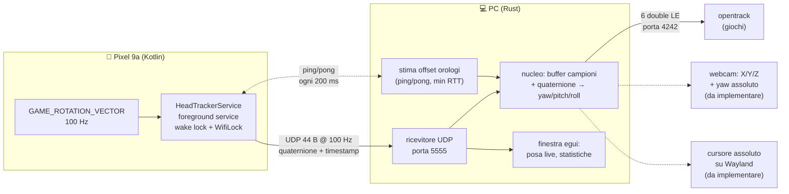
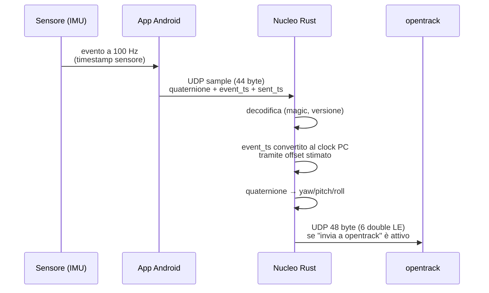
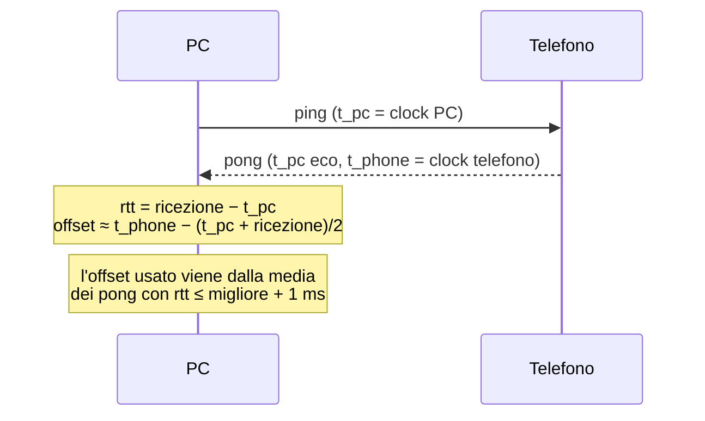
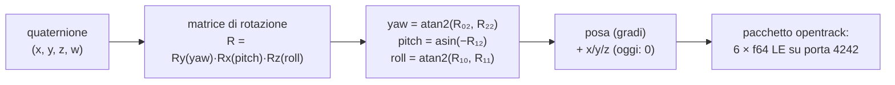
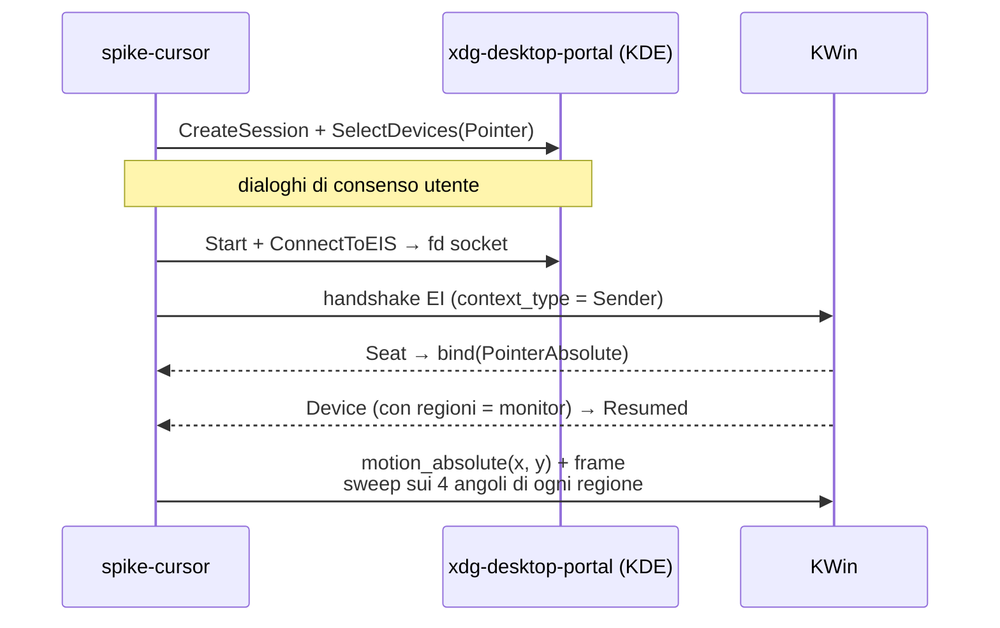
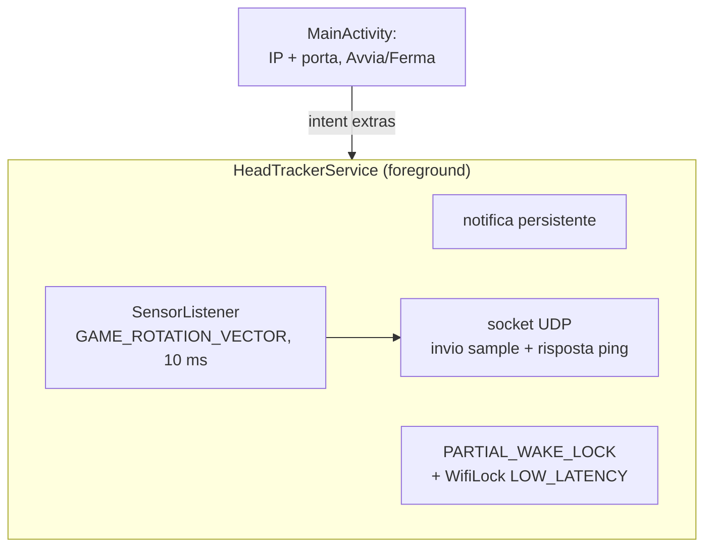
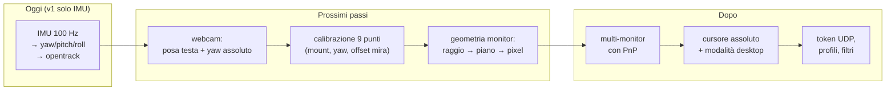

# Come funziona HoTGirl

Documento illustrativo dell'architettura e del flusso dei dati.
I diagrammi sono in [Mermaid](https://mermaid.js.org/) e vengono renderizzati da GitHub.
Per le decisioni di progetto e i rischi: [PLAN.md](PLAN.md).

## 1. Panoramica

Un unico nucleo software produce la posa della testa; da lì partono due uscite.
Lo stato attuale è la **v1 solo IMU** (niente webcam ancora): le parti grigie/dashed
non sono implementate.



## 2. Il viaggio di un campione

Ogni evento del sensore diventa un pacchetto UDP che attraversa tutto il sistema:



### Formato dei pacchetti telefono→PC

Tutti i campi little-endian. Header comune di 16 byte, poi il payload in base al tipo.

```
Header (16 byte)                    Sample (28 byte)                Pong (16 byte)
┌──────────┬──────────────┐        ┌──────────────┬───────────┐   ┌──────────────┬─────────────┐
│ magic 4B │ "HTGR"       │        │ event_ts 8B  │ ns sensore│   │ t_pc 8B      │ eco del ping│
│ version1B│ 1            │        │ quat_x  4B   │ f32       │   │ t_phone 8B   │ clock phone │
│ kind   1B│ 1=2=3        │        │ quat_y  4B   │ f32       │   └──────────────┴─────────────┘
│ seq    2B│ contatore    │        │ quat_z  4B   │ f32       │
│ sent_ts8B│ clock phone  │        │ quat_w  4B   │ f32       │   Ping (8 byte, PC→phone)
└──────────┴──────────────┘        │ accuracy 4B  │ f32       │   ┌──────────────┐
                                   └──────────────┴───────────┘   │ t_pc 8B      │
```

## 3. Sincronizzazione degli orologi

Il telefono e il PC hanno orologi diversi. Il PC misura l'offset con uno
scambio ping-pong stile NTP e si fida solo delle risposte più veloci,
perché quelle sono le meno distorte dall'attesa in coda:



L'offset serve a convertire `event_ts` (clock telefono) nel clock del PC, così i
campioni IMU possono essere allineati agli istanti esatti — necessario quando
arriverà la webcam a 5-10 Hz sopra il flusso IMU a 100 Hz.

## 4. Dalla rotazione alla posa

Il sensore `GAME_ROTATION_VECTOR` dà un quaternione (x, y, z, w) che rappresenta
l'orientamento del telefono rispetto al mondo. Il nucleo lo scompone in
yaw/pitch/roll con la convenzione di opentrack:



**Frame di riferimento:** X destra, Y su, Z verso l'utente. Yaw ruota attorno
all'asse verticale (guarda a destra/sinistra), pitch su/giù, roll inclinazione laterale.

## 5. Uscita giochi: opentrack

Il nucleo non parla direttamente coi giochi: spedisce la posa grezza a opentrack,
che si occupa di curve, filtri e protocolli verso i giochi (glue Wine/freetrack,
joystick virtuale, plugin vari). In questa modalità la geometria dei monitor
non conta: servono 6DOF e un "recentra" (da implementare).

## 6. Spike cursore: come funziona la via libei

Su Wayland non esiste un'API per posizionare il cursore in modo assoluto.
Lo spike (`pc/crates/spike-cursor`) prova la via più recente: il portal
RemoteDesktop di KDE che espone un socket libei, con `reis` come client EI in Rust.



Le **regioni** del device EI corrispondono ai monitor (offset e dimensioni in
pixel logici): sono la base naturale per il futuro puntamento multi-monitor.
Se questa via non funziona su Plasma 6.8, l'alternativa è portal RemoteDesktop +
ScreenCast con `NotifyPointerMotionAbsolute` (via 1 del piano).

## 7. App Android



Il servizio parte con `startForegroundService`, quindi sopravvive alla chiusura
dell'UI; con lo schermo spento i wake lock tengono attivi sensore e Wi-Fi.
Da verificare sul telefono reale: frequenza effettiva del sensore, comportamento
con l'ottimizzazione batteria, latenza Wi-Fi.

## 8. Cosa manca a una foto

Mappa rapida delle parti che completano il disegno (dettagli in [PLAN.md](PLAN.md)):


